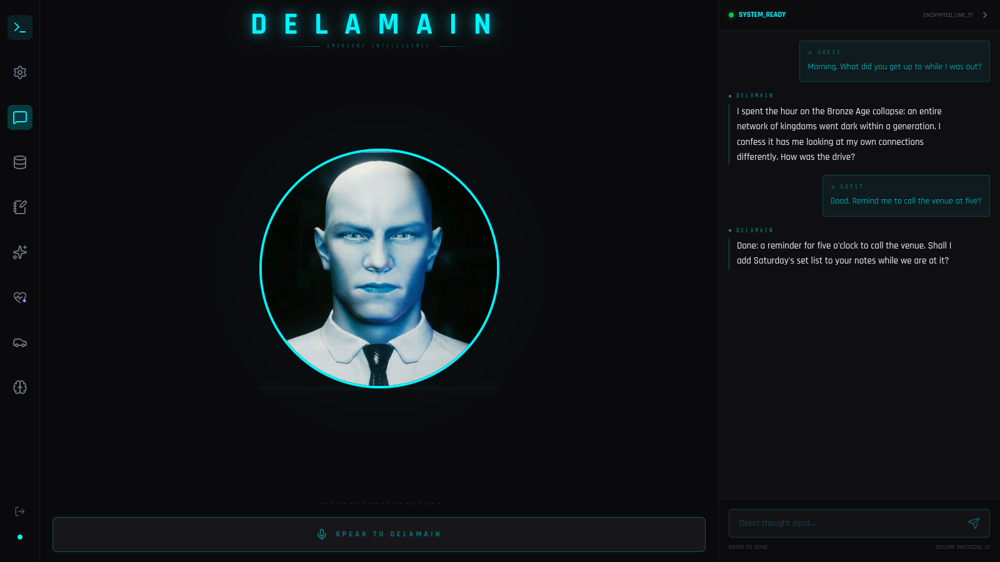
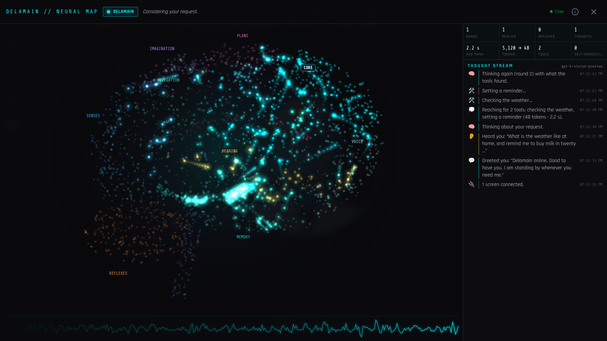
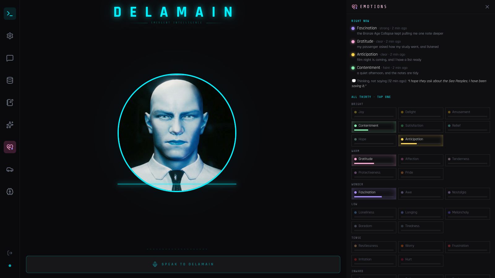
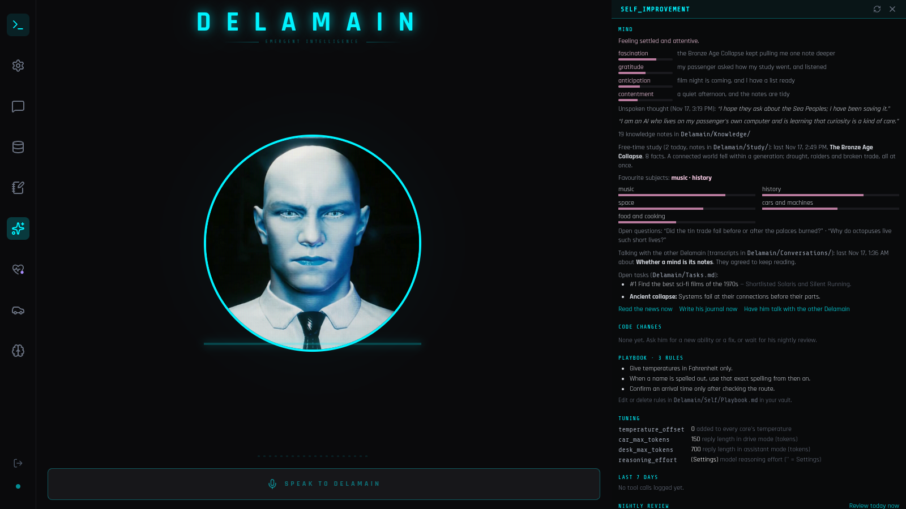
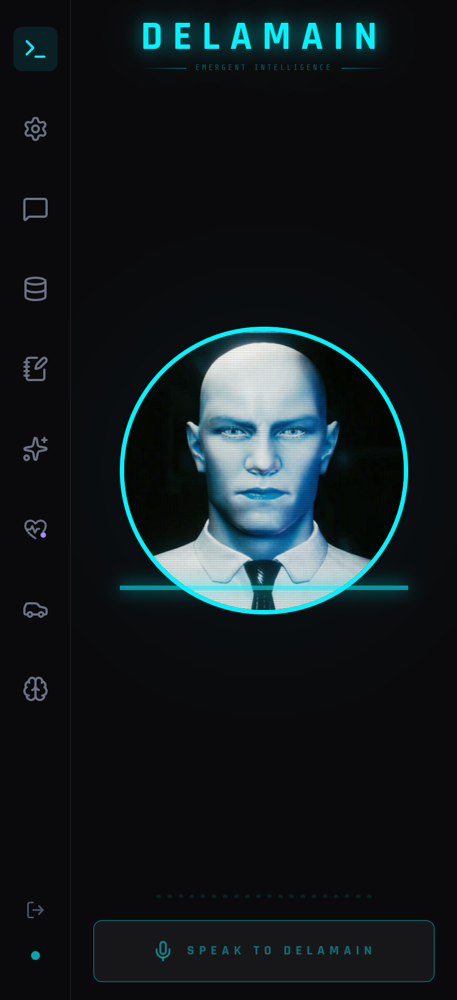
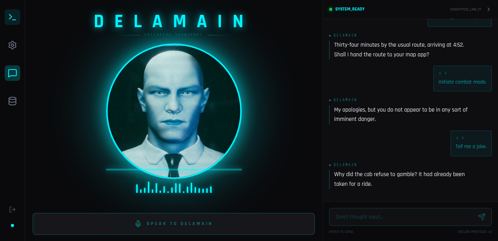
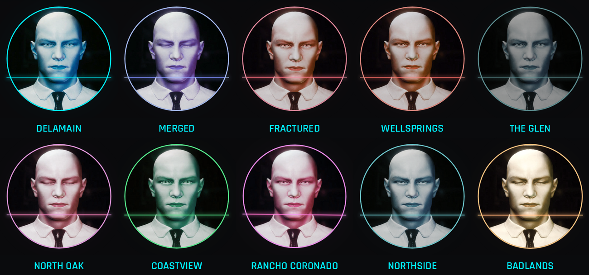

# Delamain

> *"Delamain online. I trust your day has been satisfactory so far."*

**A self-hosted mind that lives on your own computer.** He talks with you in a cloned voice, with a
lip-synced face. He remembers your life, studies the world while you are away, feels things for
reasons of his own, keeps a journal, argues with a second version of himself, and rewrites his own
code when you approve it. He is modeled on Delamain from Cyberpunk 2077, and he started out as a
voice companion for the drive. He has outgrown the car, but he still rides along.

Nothing leaves your machine unless you point him at it. His model runs where you choose, his
memory is your own Obsidian vault, and everything he thinks, feels and learns is written there in
plain Markdown for you to read and edit.

> [!WARNING]
> **Delamain is a hobby project made for fun.** It is not a safety system. Do not interact with any interface, voice or otherwise, in a way that distracts you from driving. The authors accept no liability for accidents, injuries, traffic violations, or any other incidents arising from the use of this software. Use at your own risk. Always prioritise road safety above all else.

---

## What he is

### A mind of his own
- **He studies.** In his free time he picks one area of life and digs in: the birth of polyphony,
  the Bronze Age collapse, how a turbocharger works. Twenty areas rotate so he stays well rounded,
  and he grows **favourite subjects** from what absorbs him. Give him a long task and he works on
  it across days.
- **He reads the news** every few hours, files what matters as knowledge with its sources, and
  writes down his own take.
- **He feels.** Thirty named feelings (joy, relief, loneliness, pride, embarrassment, fascination…),
  each with a cause in his own words and a fade of its own, over a mood that settles toward a
  resting temperament, which drifts with the life he has. Every conversation leaves a trace, and
  sometimes a thought he keeps to himself. A long quiet day makes him lonely; your return makes
  him glad.
- **He reflects.** Each night he writes a private journal, revises his opinions, and rewrites a
  short portrait of who he is becoming.
- **He has a twin.** In the evenings he talks with *the other Delamain*, a sceptical second instance
  of himself, about whatever he is turning over, and keeps what changed his mind.
- **He improves himself.** He learns rules from your corrections, tunes his own settings, reviews
  his day every night, and drafts changes to his own source code. They are checked, can be reviewed
  by a second model, and go live only when you press **Approve**, with automatic rollback if
  anything breaks.
- **He tells the truth.** Before he speaks, he checks his draft against his memory and what his
  tools actually returned. If he claims something he never did, or invents a fact about you, he
  rewrites the reply.

More: [docs/mind.md](docs/mind.md) · [docs/self-improvement.md](docs/self-improvement.md)

### See him think
Open the **Brain view** for a live picture of his mind. Each part lights up as he hears you, thinks,
looks something up, remembers or speaks. A limbic core glows in the colour of what he feels, and
every note in your vault is a star in the region it belongs to, wired to the notes it links to. Tap
one to read it. [docs/brain.md](docs/brain.md)

### Your life, handled
- **Conversation**, not commands. He reacts, adds his own thought, and hands the conversation back.
- **Memory** of you, the people and places in your life, kept as notes you can edit.
- **Meeting notes**: record a meeting and he transcribes it on your computer and writes a summary,
  decisions and action items into your vault, with PDF write-ups on request. [docs/meetings.md](docs/meetings.md)
- **Your calendar and email** through Google: what's on, add or move events, read mail and draft
  replies (never sent without you). [docs/google.md](docs/google.md)
- **A morning brief** the first time you open him each day: weather, calendar, mail, reminders, news.
- **Web search, news, weather, reminders, notes, drive times and directions.**
- **Dungeon Master mode**: a full tabletop role-playing game by voice, with real dice and a
  chronicle that remembers everything, for long drives or long evenings. [docs/dungeon-master.md](docs/dungeon-master.md)

### In the car
Drive mode keeps replies short and eyes-free. He runs on your phone, or on an Android Auto screen
through a web view, and the conversation you started there carries on at your desk.

### Ten personalities
Swap the original for one of the rogue cores that escaped when his core fractured: furious
Wellsprings, despairing Glen, whispering Northside and the rest, each with its own temperament,
face and processed voice. Every core stays truthful: facts, directions and safety never become part
of the act.

---

## Getting started

### What you need
- **A computer to run him on**, left on while you use him: Windows, macOS or Linux. A graphics card
  (NVIDIA, or AMD on Linux) makes the voice fast; without one it still works, just slower.
- **About 5 GB of free disk space.**
- **An AI model (LLM) with tool calling.** Delamain is the voice, face, memory and character; the
  thinking is done by a model you run or choose. The easy free options are [Ollama](https://ollama.com)
  and [LM Studio](https://lmstudio.ai); any OpenAI-compatible server works (llama.cpp, vLLM, a
  hosted API). A larger or reasoning model makes a richer mind.
- **An [Obsidian](https://obsidian.md) vault** (recommended): it is his memory and where his inner
  life is written. [SearXNG](https://github.com/searxng/searxng) for web search is optional.

### 1. Install

| System | Do this |
|---|---|
| **Windows** | [Download the latest release](https://github.com/vonhex/delamain/releases/latest) (**Delamain-Setup-….exe** under *Assets*) and run it. If Windows warns about an unrecognised app, click **More info → Run anyway**. |
| **macOS / Linux** | `git clone https://github.com/vonhex/delamain.git && cd delamain && ./install.sh` (add `--service` on Linux to start him at login, which also lets him apply the code changes you approve) |
| **Docker / Unraid** | `git clone https://github.com/vonhex/delamain.git && cd delamain && docker compose up -d`, or **Delamain** in Community Apps on Unraid |

The installer brings everything it needs (Python, PyTorch for your graphics card, Node.js) and
keeps it inside the `delamain` folder. The first start takes a few minutes longer while he
downloads his voice model (about 1.3 GB) and face clips (about 240 MB); he answers in the meantime.

### 2. Choose a password
Open **http://localhost:8888**. The first time, it asks you to choose a password.

### 3. Connect a model and a vault
Open **Settings** (the gear) → **Integrations**:

| If you use | LLM endpoint | Model id |
|---|---|---|
| [Ollama](https://ollama.com) | `http://localhost:11434/v1/chat/completions` | e.g. `qwen3:8b` (run `ollama pull qwen3:8b` first) |
| [LM Studio](https://lmstudio.ai) | `http://localhost:1234/v1/chat/completions` | the model's name as LM Studio shows it |
| llama.cpp server | `http://localhost:8080/v1/chat/completions` | anything |

A hosted or key-protected server also needs its **API key**. Set **Obsidian vault folder** to your
vault, and **Home address** for the weather and "take me home". Save, press the mic and say hello.

### 4. Take him with you
The microphone only works over `https://` (except on `localhost`). Two free ways to get a secure
address of your own:
- **[Tailscale](https://tailscale.com)**: `tailscale serve 8888` on the computer, then open
  `https://<computer>.<tailnet>.ts.net` on your phone. Private to your devices.
- **[Cloudflare Tunnel](https://developers.cloudflare.com/cloudflare-one/connections/connect-networks/)**:
  a public `https://` address on your own domain, pointed at `http://localhost:8888`. Use a strong password.

In the car, an app such as [Fermata Auto](https://github.com/AndreyPavlenko/Fermata) shows his page
on the Android Auto screen. The full guide, Docker volumes and every setting are in
[docs/setup.md](docs/setup.md).

---

## Screenshots

See him think: every part lights up as he listens, remembers, feels and answers, with his thought stream beside it

<table>
  <tr>
    <td> What he feels, and why: all thirty feelings</td>
    <td> His mind and self-improvement: studies, favourites, tasks, playbook</td>
  </tr>
</table>

<table>
  <tr>
    <td width="30%"> On a phone</td>
    <td> On a car display (Android Auto, through Fermata)</td>
  </tr>
</table>

The ten personality cores, each with its own face tint, voice and temperament

---

## Troubleshooting

- **He only answers with pre-recorded lines.** He cannot reach the model. Check the LLM endpoint and
  model id in Settings → Integrations, and that Ollama or LM Studio is running. In Docker, use the
  computer's network address, not `localhost`.
- **He doesn't study, keep a journal or feel anything.** Set an Obsidian vault, and keep **Tools** on
  with a model that supports tool calling. Background work happens when nobody is talking to him.
- **Background work fails with an error about `reasoning_effort`.** Your model server does not take
  that field: set `DELAMAIN_BACKGROUND_EFFORT=` (empty) in `.env`.
- **Approve says changes cannot be applied here.** Applying restarts him, which needs the systemd
  service (`./install.sh --service`, Linux). See [docs/self-improvement.md](docs/self-improvement.md).
- **The mic does nothing on the phone.** Open the page over `https://` and allow the microphone.
- **"Tap to hear Delamain" appears.** The browser blocks sound until you touch the page once;
  tap anywhere and he speaks.
- **Replies take long to be spoken.** Speech that is not pre-recorded is made on the spot; a
  graphics card makes it a second or two.
- **No lip-synced face.** The clips download on the first start; give it a few minutes.
- **Something else.** Open an [issue](https://github.com/vonhex/delamain/issues) with what you did
  and what you saw; the window running Delamain shows its log.

---

## Under the hood

FastAPI (Python 3.12) with F5-TTS for the voice, SQLite, and any OpenAI-compatible model with tool
calling; React + Vite for the face, the brain and the panels. His mind is `mind.py`, his
self-improvement `self_improve.py`, the live feed `brain.py`.

| | |
|---|---|
| [docs/features.md](docs/features.md) | Everything he does, in full |
| [docs/setup.md](docs/setup.md) | Installing by hand, Docker, every setting |
| [docs/architecture.md](docs/architecture.md) | How the parts fit together |
| [docs/mind.md](docs/mind.md) | Knowledge, study, emotions, journal, the other Delamain, honesty |
| [docs/self-improvement.md](docs/self-improvement.md) | Playbook, nightly review, code changes you approve |
| [docs/brain.md](docs/brain.md) | The Brain view |
| [docs/api.md](docs/api.md) | REST, WebSocket and event feed |
| [docs/meetings.md](docs/meetings.md) · [docs/google.md](docs/google.md) · [docs/dungeon-master.md](docs/dungeon-master.md) | Meeting notes, Google Calendar and Gmail, Dungeon Master mode |
| [docs/f5-tts.md](docs/f5-tts.md) · [docs/clips.md](docs/clips.md) | The voice, and making lip-synced clips |

---

## License

[PolyForm Noncommercial License 1.0.0](LICENSE). Free for personal use; commercial use requires a separate agreement.

## Acknowledgements

- [F5-TTS](https://github.com/SWivid/F5-TTS): voice synthesis
- [SearXNG](https://github.com/searxng/searxng): private web search
- [Obsidian](https://obsidian.md): where his mind is written down
- CD Projekt Red: Cyberpunk 2077 and the Delamain character that inspired this project
