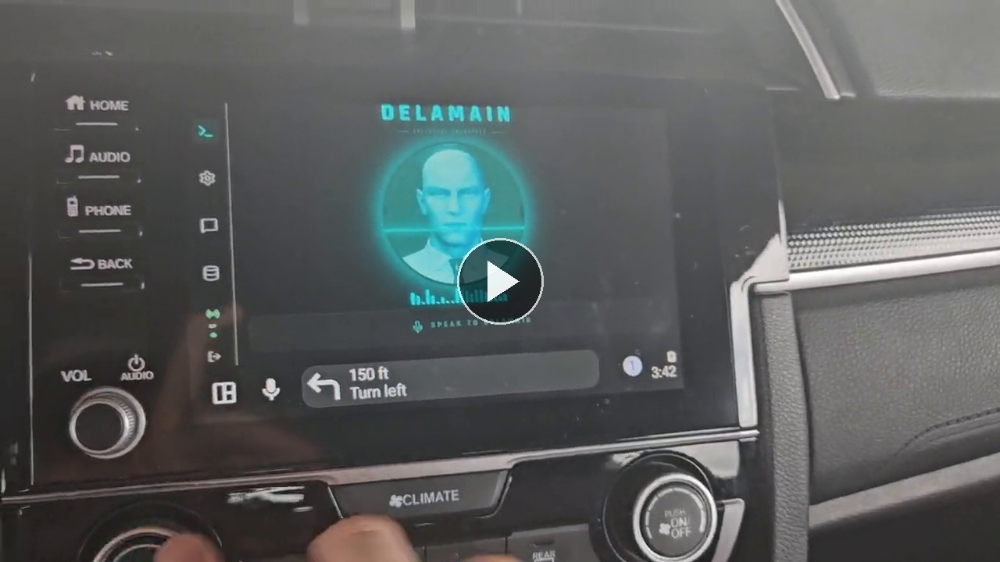
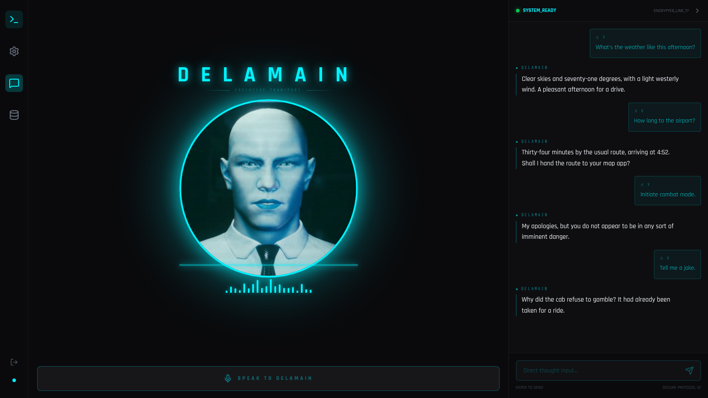
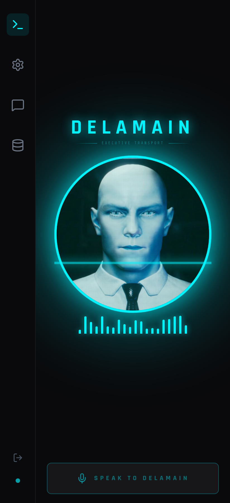
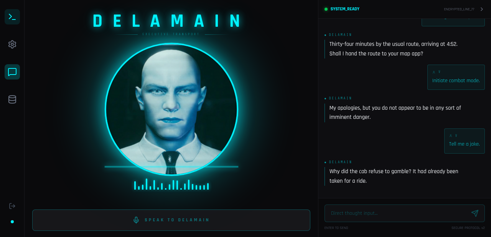
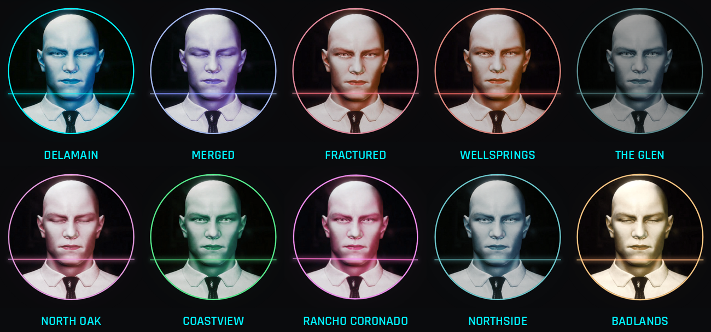
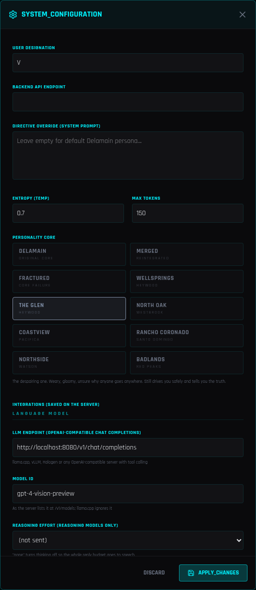
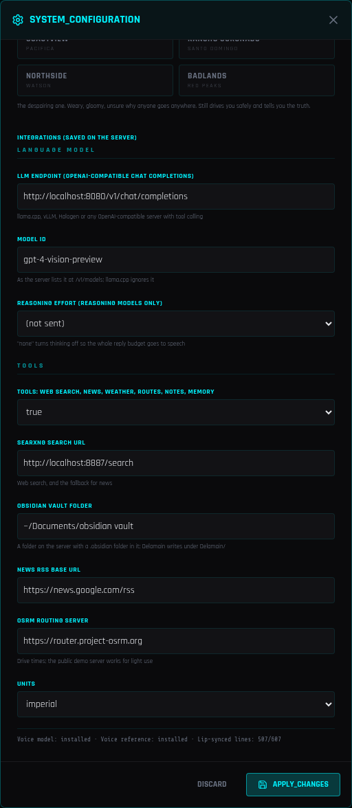
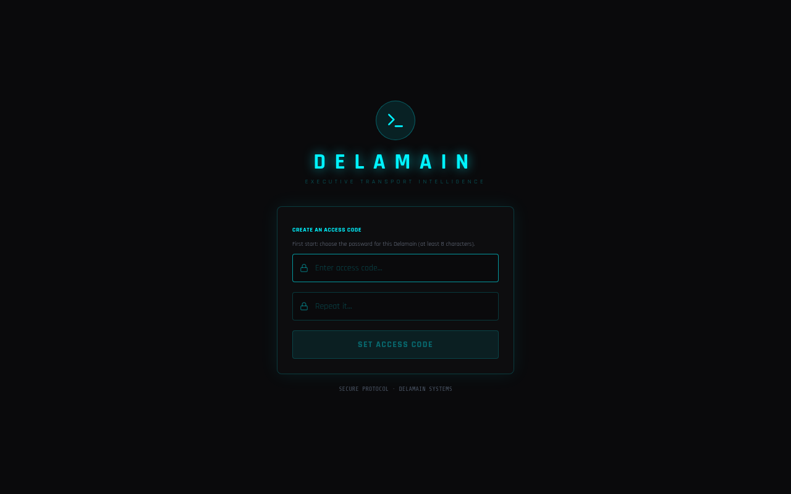
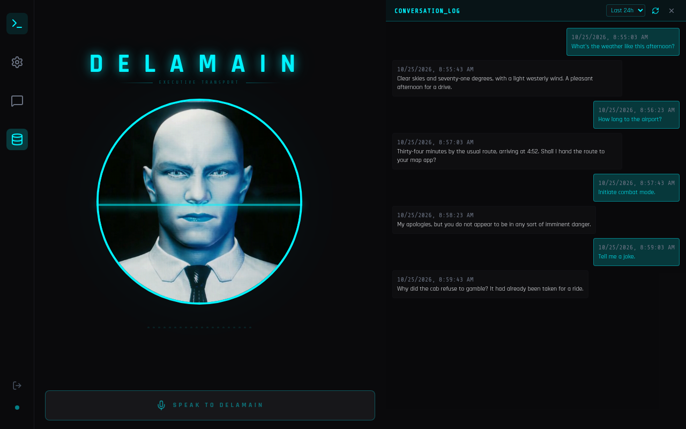

# Delamain

> *"Delamain online. I trust your day has been satisfactory so far."*

> [!WARNING]
> **Delamain is a hobby project made for fun.** It is not a safety system. Do not interact with any interface, voice or otherwise, in a way that distracts you from driving. The authors accept no liability for accidents, injuries, traffic violations, or any other incidents arising from the use of this software. Use at your own risk. Always prioritise road safety above all else.

A voice companion for the drive, modeled on Delamain from Cyberpunk 2077. You run it on a computer at home, then open it in a web browser on your phone, or on your car's Android Auto screen. Talk to it and it answers in Delamain's voice, with his face moving as he speaks. It can search the web, read you the news and the weather, tell you how long a drive will take, remind you of things, keep notes, and send directions to your phone's map app.

---

## What you need

- **A computer to run it on**, left on while you use it: Windows, macOS or Linux. A graphics card (NVIDIA, or AMD on Linux) makes the voice fast. Without one it still works, but answers that are not pre-recorded take a while to be spoken.
- **About 5 GB of free disk space** for the voice model, the face videos and the software.
- **An AI model (LLM) for the conversation.** Delamain is the voice, face and personality; the thinking is done by a language model you run yourself. The easiest free option is [Ollama](https://ollama.com) or [LM Studio](https://lmstudio.ai), both of which run on the same computer (see [Step 3](#3-connect-an-ai-model)). Any OpenAI-compatible server that supports tool calling works, such as llama.cpp or vLLM.
- **A phone** (or your car's Android Auto screen) to talk to it.

Web search ([SearXNG](https://github.com/searxng/searxng)) and an [Obsidian](https://obsidian.md) vault for notes are optional extras.

---

## Getting started

### 1. Install

| System | Do this |
|---|---|
| **Windows** | [Download the latest release](https://github.com/vonhex/delamain/releases/latest) (the **delamain-v…zip** file under *Assets*), unzip it, and double-click **`install.bat`** |
| **macOS / Linux** | Open a terminal and run `git clone https://github.com/vonhex/delamain.git && cd delamain && ./install.sh` |
| **Docker / Unraid** | `git clone https://github.com/vonhex/delamain.git && cd delamain && docker compose up -d`, or install **Delamain** from Community Apps on Unraid |

The installer gets everything it needs by itself (Python, PyTorch for your graphics card, Node.js) and keeps it all inside the `delamain` folder, so it does not change the rest of your system. When it finishes, Delamain starts.

The first start takes a few minutes longer: Delamain downloads its voice model (about 1.3 GB) and his lip-synced face clips (about 240 MB), then records his fixed lines in the background. He answers in the meantime.

To start Delamain again later, run `start.bat` (Windows) or `./start.sh` (macOS / Linux). To update, download the new release (or `git pull`) and run the installer again. On Linux, `./install.sh --service` makes Delamain start by itself when you log in.

### 2. Choose a password

Open **http://localhost:8888** in a browser on the same computer. The first time, it asks you to choose a password. That password protects Delamain if you open it to the internet later.

### 3. Connect an AI model

Open **Settings** (the gear) → **Integrations** and fill in **LLM endpoint** and **Model id**. For example:

| If you use | LLM endpoint | Model id |
|---|---|---|
| [Ollama](https://ollama.com) | `http://localhost:11434/v1/chat/completions` | the model you pulled, e.g. `qwen3:8b` (run `ollama pull qwen3:8b` first) |
| [LM Studio](https://lmstudio.ai) | `http://localhost:1234/v1/chat/completions` (start the server on the Developer tab) | the model's name as LM Studio shows it |
| llama.cpp server | `http://localhost:8080/v1/chat/completions` | anything; it is ignored |

Pick a model that supports **tool calling** (Ollama marks these with a *tools* tag), or he cannot search, read the news or take notes. If replies are slow because the model "thinks" first (Qwen 3, DeepSeek R1 and similar), set **Reasoning effort** to `none`. If the AI runs on another computer, or Delamain runs in Docker, use the AI computer's network address (such as `http://192.168.1.20:11434/…`) instead of `localhost`; inside a container, `localhost` is the container itself.

Press save, go back, press the mic and say hello.

### 4. Use it on your phone and in the car

On a phone on the same Wi-Fi, open `http://<the computer's IP address>:8888` to see the page. **The microphone, however, only works over a secure (`https://`) address.** Browsers block it on plain `http://` everywhere except `localhost`. Two free ways to get a secure address:

- **[Tailscale](https://tailscale.com)**: install it on the computer and the phone, then run `tailscale serve 8888` on the computer. Delamain is then at `https://<computer-name>.<your-tailnet>.ts.net` on your phone, wherever you are, and stays private to your devices.
- **[Cloudflare Tunnel](https://developers.cloudflare.com/cloudflare-one/connections/connect-networks/)**: gives Delamain a public `https://` address on a domain you own. Anyone can reach the login page, so use a strong password.

In the car, Android Auto does not have a web browser of its own; an app such as [Fermata Auto](https://github.com/AndreyPavlenko/Fermata) can show a web page on the car screen. Open your Delamain address in it. Delamain fits the page to any screen, from a phone to a wide car display.

---

---

## Demo

[](https://github.com/vonhex/delamain/releases/download/v1.1.0/delamain-demo.mp4)

---

## Screenshots



<table>
  <tr>
    <td width="30%"><br><sub>On a phone</sub></td>
    <td><br><sub>On a car display (Android Auto, through Fermata)</sub></td>
  </tr>
</table>


<sub>The ten personality cores, each with its own face tint, voice and temperament</sub>

<table>
  <tr>
    <td><br><sub>Settings: pick a core</sub></td>
    <td><br><sub>Settings: LLM, search, Obsidian and more, saved on the server</sub></td>
  </tr>
  <tr>
    <td><br><sub>First start: choose a password</sub></td>
    <td><br><sub>Conversation log</sub></td>
  </tr>
</table>

---

## Features

- **Voice personality**: formal, measured and dry, exactly as in Cyberpunk 2077. The voice is cloned from a reference clip with F5-TTS.
- **Personality cores**: under Settings → Personality Core, swap the original for one of the rogue sub-personalities that escaped when Delamain's core fractured. Each has its own temperament, greetings, reminder lines, face color and voice, made by post-processing the synthesized audio:

  | Core | Temperament | Voice |
  |------|-------------|-------|
  | Delamain | The original: composed, formal, precise | Clean |
  | Merged | Every fragment taken back in; warmer, and now and then says "we" | Faint chorus of voices |
  | Fractured | All the fragments at once, cutting across each other | Stutters, bit-crush, static |
  | Wellsprings | Furious, foul-mouthed, contemptuous | Deep, distorted growl |
  | The Glen | Despairing, weary, gloomy | Slow, low, muffled, echoing |
  | North Oak | Gentle, sensitive, easily hurt | Soft, trembling |
  | Coastview | Sly trickster who loves a surprise | Reversed fragments, metallic |
  | Rancho Coronado | Manic, gleeful, hates lawn flamingos | Fast, high, stuttering |
  | Northside | Frightened, whispering, sure it is being tracked | Quiet, shaky, dropping out |
  | Badlands | Wistful free spirit, dreaming of the open road | Airy, distant echo |

  Every core keeps the same tools and stays truthful: facts, directions and navigation are never part of the act, safety warnings come first, and a rogue core drops the act if the passenger sounds genuinely upset.
- **Instant pre-recorded replies**: everyday messages such as "thanks", "how are you", "who are you", "tell me a joke", "good night", "I love you", "never mind" and "combat mode" are answered at once from fixed lines written for every core, with no model call and the audio already recorded. With the greetings and "one moment" lines that makes over 600 pre-recorded lines across the ten cores, more than 500 of them lip-synced. Only short messages that are nothing but one of these get a fixed reply; anything with a real question goes to the model.
- **Insult comeback**: swear at him and, now and then, instead of a reply he plays you a song from YouTube (Harley Poe's "Whiny Bitch" by default) until you press the X; change it or turn it off in Settings.
- **Combat mode**: ask him to initiate it and he answers as he did Jackie: "My apologies, but you do not appear to be in any sort of imminent danger." If you say you are being followed or threatened, he drops the joke and helps.
- **Lip-synced face**: over 500 of the pre-recorded lines (521 so far) play a lip-synced clip of Delamain saying them, made with MiniMax H3; the rest use the talking loops. The clips are published as a release download, and a new install fetches them by itself on first start. It fits any screen, from a phone to a wide car display.
- **A face that's never still**: over 150 idle animations. Delamain blinks, glances away, fidgets and gets bored when left alone, leans in while you talk, thinks while he looks something up, and glares when insulted. Late at night the screen dims and streetlights slide across his face, and once in a while a rare clip plays: a holographic city map, glowing holographic rain, a wireframe glitch and others. Each rogue core has its own idles too, from the Badlands cab gazing at a desert sunset to Rancho Coronado's manic grin and the Coastview trickster flickering out of view.
- **Set up from the browser**: on first start the page asks you to choose a password, and Settings → Integrations sets the LLM endpoint and model, SearXNG, the Obsidian vault, news, routing and units. They are saved on the server, so `.env` is optional.
- **News bulletins**: say "read me the news", "any tech news?" or "local news" and Delamain reads a short spoken bulletin of current headlines. It uses Google News RSS, with SearXNG as a fallback.
- **Reminders and timers**: "remind me in twenty minutes to call mom" or "at five, remind me to pick up the dry cleaning". Delamain speaks the reminder aloud when it's due. If you're away at that moment, he tells you as soon as you're back. Reminders are kept in the database and survive restarts.
- **Weather**: current conditions and a three-day forecast for where you are or any town, from Open-Meteo.
- **Drive time and distance**: "how long to Colorado Springs?" uses OSRM routing at typical road speeds, with an arrival estimate.
- **Picks up where you left off**: Android Auto drops and reopens the page often. On reconnect Delamain restores the last 30 minutes of conversation, and skips the fresh greeting when you've only been gone a few minutes.
- **Knows the hour and your name**: greetings fit the time of day, and he uses the name from Settings now and then.
- **Web search**: traffic, scores, opening hours, prices, places. The LLM calls SearXNG through tool calling.
- **Notes and memory**: lists, reminders and notes go into your Obsidian vault under `Delamain/`. Lasting facts about you and the people and places in your life are kept in `Delamain/Memory/`, one Markdown note per topic, and you can read and edit them in Obsidian.
- **Navigation**: "take me to the nearest Whole Foods" searches for the place, geocodes it with Nominatim, and opens your map app with the route.

  > **Navigation needs Delamain open in your phone's browser.** Inside an app's embedded browser, such as Fermata on Android Auto, a web page cannot open the Maps app. There Delamain still finds the place and tells you the destination, but you have to start the route yourself, or open Delamain in Chrome on the phone instead.
- **Voice input**: a push-to-talk microphone button using the browser's speech recognition, plus a text chat panel.
- **Conversation log**: a history panel of everything you and Delamain have said.
- **JWT authentication**: a single shared password, chosen on first start, rate-limited login and 30-day tokens.

---

## Troubleshooting

- **He doesn't answer anything except the pre-recorded lines.** Delamain cannot reach the AI model. Check the LLM endpoint and model id in Settings → Integrations, and that Ollama or LM Studio is running. In Docker, use the computer's network address, not `localhost`.
- **The mic button does nothing on the phone.** The page has to be opened over `https://` (see [step 4](#4-use-it-on-your-phone-and-in-the-car)), and the browser must be allowed to use the microphone.
- **Replies take a long time to be spoken.** Speech that is not pre-recorded is made on the spot. With a graphics card that takes a second or two; on a CPU it can take much longer. Pre-recorded lines are always instant.
- **He can't search the web or read the news.** Use a model with tool calling, and keep **Tools** on in Settings. Web search needs a [SearXNG](https://github.com/searxng/searxng) address in Settings; news works without it.
- **No lip-synced face, only the talking loop.** The clips download on the first start. Give it a few minutes, and check that the computer can reach github.com.
- **Something else.** Open an [issue](https://github.com/vonhex/delamain/issues) with what you did and what you saw; the window or terminal running Delamain shows its log.

---

## Architecture

```
┌──────────────────────────┐   WebSocket    ┌──────────────────────────────┐
│  Web UI (React + Vite)   │◄──────────────►│  Delamain backend (FastAPI)  │
│  phone / Android Auto /  │  talk, replies │  F5-TTS voice, SQLite log    │
│  any browser             │  audio URLs    └──┬──────────┬────────────┬───┘
└──────────────────────────┘                   │          │            │
                                     OpenAI-compatible  SearXNG /   Obsidian
                                     LLM (tool calling) news RSS    vault
```

- **Backend**: FastAPI on Python 3.12, F5-TTS for the voice, SQLite for the conversation log. It works with any OpenAI-compatible chat endpoint (Ollama, LM Studio, llama.cpp, vLLM, …), and the LLM uses the tools in `assistant_tools.py`.
- **Frontend**: React + Vite with Tailwind CSS v4 (cyber theme).
- More detail: [docs/architecture.md](docs/architecture.md).

---

## Requirements in detail

- Linux, macOS or Windows. The installer provides Python, PyTorch and Node.js.
- A GPU is recommended for F5-TTS (NVIDIA CUDA, or AMD ROCm on Linux). CPU works, but replies that are not pre-recorded take noticeably longer to speak.
- An OpenAI-compatible LLM endpoint with tool calling (Ollama, LM Studio, llama.cpp server, vLLM, …)
- SearXNG (optional; used for web search and as the news fallback)
- An Obsidian vault (optional; used for notes and memory)

Everything else comes with the repository or downloads itself on first start: the Delamain reference voice is included, the F5-TTS weights (about 1.3 GB) come from Hugging Face, and the lip-synced clips (about 240 MB) from this repository's `line-clips` release. The first start also records every fixed line once in the background, which takes a while on a GPU and longer on a CPU; Delamain answers in the meantime.

---

## Installation

The [Getting started](#getting-started) steps above are all most people need. To do the same steps by hand:

```bash
git clone https://github.com/vonhex/delamain.git
cd delamain
python -m venv venv
source venv/bin/activate
pip install torch torchaudio      # pick the build for your GPU at https://pytorch.org
pip install -r requirements.txt
(cd frontend && npm ci && npm run build)
./start.sh
```

Open `http://localhost:8888`, choose a password, and point Settings → Integrations at your LLM (and SearXNG and Obsidian vault, if you use them). The backend serves the web UI, and the voice model and lip-synced clips download on the first start.

- **Change the password** later with `python auth.py set-password <new-password>`.
- **Environment variables** still work and are used for anything not set in Settings: copy `.env.example` to `.env`. `PORT` changes the port.
- **Your own voice**: replace `delamain_ref_10s.wav` (or set `DELAMAIN_REF_AUDIO`) and edit `REF_TEXT` in `tts_engine.py` to match exactly what is spoken. See [docs/f5-tts.md](docs/f5-tts.md).
- **Frontend development**: `cd frontend && npm run dev` serves the UI with hot reload on `http://localhost:5173`, proxying to the backend.

The full guide is in [docs/setup.md](docs/setup.md).

To make and add more lip-synced clips of your own, see [docs/clips.md](docs/clips.md).

---

## Docker

The image bundles the web UI, so one container serves everything on port 8888.

```bash
docker compose up -d
```

Then open `http://<server>:8888`, choose a password and fill in Settings → Integrations. A `.env` next to `docker-compose.yml` is optional and sets the same values. In the container, the Obsidian vault is mounted at `/vault` (set `OBSIDIAN_VAULT_PATH` before `docker compose up` to choose the folder on the host). Pre-built images: `ghcr.io/vonhex/delamain:latest`, or a release tag such as `ghcr.io/vonhex/delamain:1.4`.

| Volume | Holds |
|---|---|
| `/app/checkpoints` | F5-TTS model weights, downloaded on first start |
| `/app/data` | Database, settings, recorded audio and the lip-synced clips (downloaded on first start) |
| `/vault` | Optional Obsidian vault for notes and memory |

---

## Environment Variables

All optional. The ones marked ⚙ can also be set in Settings → Integrations, which takes precedence.

| Variable | Default | Description |
|---|---|---|
| `LLM_URL` ⚙ | `http://localhost:8080/v1/chat/completions` | OpenAI-compatible chat completions endpoint |
| `LLM_MODEL` ⚙ | `gpt-4-vision-preview` | Model id sent to the endpoint (check its `/v1/models`) |
| `LLM_REASONING_EFFORT` ⚙ | *(unset)* | For reasoning models: `none` turns thinking off so the whole reply budget goes to speech |
| `TOOLS_ENABLED` ⚙ | `true` | Let the LLM call web search, news, notes and memory |
| `SEARXNG_URL` ⚙ | `http://localhost:8887/search` | SearXNG instance for web search and the news fallback |
| `NEWS_RSS_URL` ⚙ | `https://news.google.com/rss` | Google News RSS base used by the news tool |
| `OBSIDIAN_VAULT_PATH` ⚙ | `~/Documents/obsidian vault` | Vault for notes; Delamain writes under `Delamain/` |
| `DELAMAIN_MEMORY_DIR` | `<vault>/Delamain/Memory` | Where long-term memory notes live |
| `DELAMAIN_UNITS` ⚙ | `imperial` | `imperial` (°F, mph, miles) or `metric` for weather and routes |
| `DELAMAIN_LINES_DIR` | `<repo>/line_clips` | Lip-synced face clips for pre-recorded lines, as `<clip id>.mp4` with their soundtrack as `<clip id>.wav` |
| `OSRM_URL` ⚙ | `https://router.project-osrm.org` | OSRM routing server for drive times (public demo server by default) |
| `DELAMAIN_CLIPS_URL` | the `line-clips` release | Where a new install downloads the lip-synced clips from; empty to skip |
| `DELAMAIN_REF_AUDIO` | `delamain_ref_10s.wav` | Reference clip the voice is cloned from |
| `ALLOWED_ORIGINS` | `http://localhost:5173,http://localhost:4173` | Only needed when a page on another site calls the API (CORS). Opening Delamain directly, or through a tunnel or reverse proxy, works without it |

---

## API

| Endpoint | Auth | Description |
|---|---|---|
| `GET /api/setup`, `POST /api/setup` | — | First start: whether a password is needed, and set it (only while none is set) |
| `POST /api/login` | — | Authenticate, receive JWT |
| `GET /api/config`, `PUT /api/config` | JWT | Server settings (Settings → Integrations) and what is installed |
| `GET /health` | — | Health check |
| `WS /ws/{client_id}?token=&persona=&user_name=` | JWT | Main WebSocket: talk, replies, reminders, audio |
| `GET /api/data/conversations` | JWT | Conversation history |
| `POST /api/chat` | JWT | Single-turn chat (REST fallback) |

Details in [docs/api.md](docs/api.md).

---

## License

[PolyForm Noncommercial License 1.0.0](LICENSE). It is free for personal use; commercial use requires a separate agreement.

---

## Acknowledgements

- [F5-TTS](https://github.com/SWivid/F5-TTS): voice synthesis
- [SearXNG](https://github.com/searxng/searxng): private web search
- CD Projekt Red: Cyberpunk 2077 and the Delamain character that inspired this project
