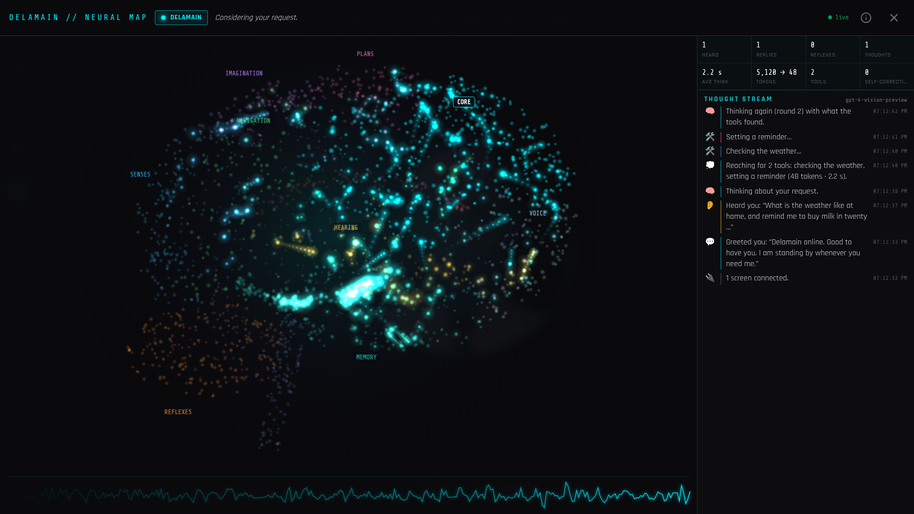

# Delamain's brain

The **Brain** view shows what Delamain is doing while he does it. Open it with the brain
button in the left sidebar, or add `#brain` to the address
(`http://localhost:8888/#brain`) to open it straight away, for example on a second screen
or a phone propped on the dash. Esc or the ✕ closes it.

It is not a generic picture of "an AI". Every flash is a real event from Delamain's own
backend: the moment he hears you, each call to the language model (with its token counts
and timing), each tool he uses, each time he catches himself out, the voice being
synthesized, and the reply leaving his mouth.

## Reading the brain

The dots are a map of jobs, not real neurons. Each region lights up when Delamain uses it.
Tap a region (or hover it with a mouse) for a one-line explanation, and press ⓘ for the key.

| Region | Where | Lights up when |
|---|---|---|
| **Hearing** | auditory cortex, side of the brain | your message arrives. Your words fly into it from the left. |
| **Core** | frontal lobe | the language model is thinking. It takes the colour of the active **personality core**: cyan for the original, orange for Wellsprings, and so on. Switching core sends a ripple through it. |
| **Senses** | visual cortex, back of the brain | he looks at the world: `web_search`, `read_webpage`, `get_news`, `get_weather` |
| **Navigation** | parietal lobe | `get_route`, and finding the places in a `[NAVIGATE:]` reply |
| **Plans** | strip across the top | `set_reminder`, `list_reminders`, `cancel_reminder` |
| **Imagination** | top of the back | Dungeon Master mode: the adventure tools, and the scribe writing up the chronicle in the background |
| **Memory** | temporal lobe and the hippocampus curl inside | `remember`, `forget` and the Obsidian note tools |
| **Voice** | Broca's area, front-low | F5-TTS synthesizing his reply. His words leave from here, in the core's colour. |
| **Reflexes** | cerebellum | an instant pre-recorded reply ("thanks", "how are you", "pause the game", an insult song). The signal goes straight from Hearing to the cerebellum and on to Voice: a reflex arc that never touches the cortex, because no language model is needed. |
| **Conscience** | the band deep inside | he catches himself promising something he has not done ("I shall check", "I have saved that") and is sent back to actually do it |

**Signals.** There are no connecting lines. Each signal is a glowing particle with a comet
tail that hops from neuron to neuron along a real path through the brain, lighting each
neuron it passes. While the model thinks, comets run from Memory, Hearing and the senses
into the Core. When it reaches for a tool they run from the Core to that tool's region and
back with the result. When the LLM server publishes its speed, the thinking comets run at
roughly one per generated token.

**Flares** float up from a region for a moment: "48 tokens · 2.2 s · → 2 tools" when a
model call finishes, "checking the weather" as a tool starts, "reflex · thanks".

**The EEG strip** along the bottom follows the phase: a slow resting wave when idle, a
quicker one while hearing or speaking, dense spikes while thinking, and a jolt when his
conscience fires.

## The thought stream

The panel on the right (below the brain on a phone) narrates every event in plain words,
newest first:

> 👂 Heard you: "What is the weather like at home, and remind me to buy milk in twenty…"
> 🧠 Thinking about your request.
> 💭 Reaching for 2 tools: checking the weather, setting a reminder (48 tokens · 2.2 s).
> 🛠️ Checking the weather…
> 🫢 Caught himself claiming to have saved something without saving it. Going back to do it.
> 💬 Said: "It is a mild fourteen degrees at home…"

Above it are today's numbers: messages heard, replies, reflex replies, model calls ("thoughts"),
average thinking time, tokens in → out, tools used and self-corrections. They reset at midnight
and when the backend restarts.

## How it works

`brain.py` is a small event bus. `main.py` calls `brain.emit()` at the real moments of a
turn; nothing in it changes a reply. The page subscribes with Server-Sent Events.

| Event | Sent when | Notable fields |
|---|---|---|
| `heard` | a `talk` message arrives | `text` (first 300 characters), `persona`, `dungeon` |
| `reflex` | a pre-recorded reply, song or instant "pause" answers it | `what` (the intent, e.g. `thanks`) |
| `think_start` / `think_end` | each call to the LLM (every tool-loop round, the tools-off reply, the DM scribe) | `round`, `source` (`reply` or `scribe`), `ms`, `prompt_tokens`, `completion_tokens`, `reasoning_tokens`, `tps`, `calls` (tools the model chose) |
| `tool_start` / `tool_end` | each tool call, and the automatic search when tools are off | `name`, `region`, `ms`, `chars` |
| `correction` | a reply claimed a save, promised an action or started the news without the headlines, and is sent back | `reason` (`save`, `action`, `news`), `promise` |
| `navigate` | a `[NAVIGATE:]` destination has been geocoded | `options` |
| `voice_start` / `voice_end` | F5-TTS synthesis | `chars`, `ms`, `ok` |
| `spoke` | a reply, greeting or reminder is sent to the page | `text` (first 400 characters), `source`, `persona`, `dungeon` |
| `core` | a page switches personality core | `persona` |
| `clients` | a page connects or disconnects | `count` |
| `error` | a reply failed and the error line was spoken | `message` (the exception type only) |

Token counts and speed come from the chat completion's `usage` (and `timings`, which
llama.cpp adds). Separately, while a Brain view is open the backend reads the LLM server's
Prometheus `/metrics` every few seconds, if it publishes one (llama.cpp does with
`--metrics`), and shows the generation speed in the header. A server without it is simply
skipped.

The feed is in memory: the last 120 events and today's counts. Nothing is written to disk.
The text of what you said and what he replied is in the feed, so the events endpoint needs
the same token as the WebSocket.

Endpoints: `GET /api/brain/snapshot` (JWT) and `GET /api/brain/events?token=` (SSE). See
[api.md](api.md#get-apibrainsnapshot).

The renderer is `frontend/src/components/brain/brainRenderer.ts` (canvas 2D, no
libraries) and the page around it is `frontend/src/components/BrainView.tsx`. With
`prefers-reduced-motion` the brain stays still and only lights up.
